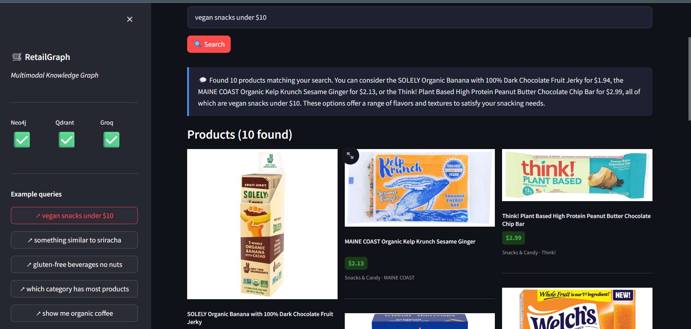
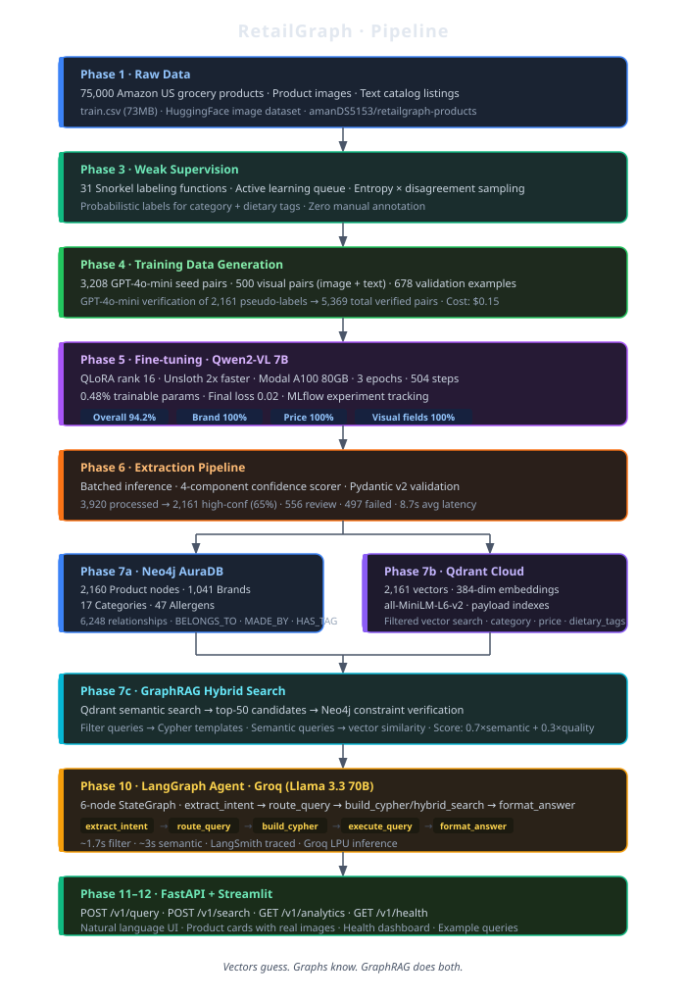
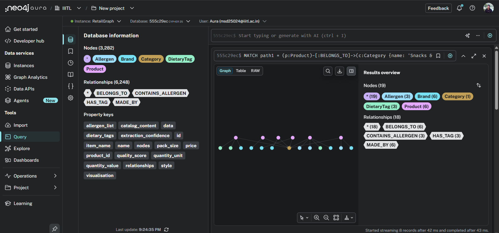

<div align="center">

# RetailGraph

**Entity extraction + knowledge graph + GraphRAG agent for grocery product catalogs.**

A fine-tuned Qwen2-VL 7B turns raw product listings into structured entities → they load into a typed Neo4j graph and a Qdrant vector index → a LangGraph agent answers plain-English questions with graph, vector or hybrid retrieval.

[](https://github.com/AmanDataGuy/RetailGraph/actions/workflows/ci.yml)
[](https://python.org)
[](https://huggingface.co/Qwen/Qwen2-VL-7B-Instruct)
[](https://neo4j.com)
[](https://qdrant.tech)
[](https://langchain-ai.github.io/langgraph/)

</div>

---

## What it does

Grocery listings go in as text → the fine-tuned model extracts category, quantity, unit, dietary tags and allergens → records are deduplicated and loaded into Neo4j (5 node types, 4 relationship types) and embedded into Qdrant → a 6-node LangGraph agent routes each question to exact Cypher filters, GraphRAG hybrid search, or graph analytics, and answers with Groq `openai/gpt-oss-120b`.



---

## Results

### Agent — 30 golden queries, live stack (2026-11-11)

`eval/collect_results.py` runs the real agent against Neo4j + Qdrant + Groq and checks it against hand-verified gold Cypher. No LLM judge.

| Metric | Score |
|---|---|
| Route accuracy (Cypher / GraphRAG / analytics) | **96.7%** (29/30) |
| Execution accuracy — agent's true match count == gold count | **94.7%** (18/19) |
| Analytics answers contain the right name + number | **100%** (4/4) |
| Intent label accuracy | 90.0% (27/30) |
| Latency p50 / max (incl. 2 LLM calls) | 3.1 s / 11 s |

Raw per-query rows: `evaluation/agent_eval_raw.json`.

### Extraction — Qwen2-VL 7B + QLoRA, 678 val examples

| Field | Exact match | LLM judge (GPT-4o-mini) |
|---|---|---|
| Quantity unit | 92.6% | — |
| Allergen list | 91.5% | 4.68 / 5 |
| Quantity value | 88.2% | — |
| Dietary tags | 85.7% | 4.47 / 5 |
| Category | 78.3% | 4.22 / 5 |
| **Mean of the 5 fields** | **87.3%** | 0 parse errors · 8.7 s/product |

- Brand and pack size were never in the teacher labels, and price is copied from the input, so they are left out of the mean.
- Ground truth is GPT-4o-mini teacher labels, not human labels. The val split overlaps training through the visual pairs (see *Limitations*).
- The judge surfaced 38 dietary-tag predictions that were correct but failed string equality.

### Knowledge graph

**2,160** products · **6,248** relationships · 1,041 brands · 17 categories · 17 dietary tags · 47 raw allergen strings · **2,161** Qdrant vectors (all-MiniLM-L6-v2, 384-dim).

### Retrieval smoke test — `scripts/run_benchmark.py`

| System | Passed (30 queries) | Avg latency |
|---|---|---|
| Vector only (Qdrant) | 24 | 0.62 s |
| Graph only (Neo4j) | 29 | 1.76 s |
| GraphRAG (hybrid) | 25 | 0.91 s |

Several checks only test that results came back, so this is a smoke test, not a retrieval-quality score. Graph-only wins on multi-hop and aggregation queries, which is why the agent routes those to Cypher.

---

## Architecture



1. **Extraction (offline).** GPT-4o-mini / GPT-4o teacher labels → Pydantic v2 validation (2 attempts per product) → QLoRA (rank 16, 4-bit) fine-tune of Qwen2-VL 7B on a Modal A100 via Unsloth. Snorkel weak supervision with 31 labeling functions. New teacher runs use free Groq models.
2. **Knowledge graph (offline).** RapidFuzz deduplication (`token_sort_ratio ≥ 92`) → Neo4j `Product` / `Brand` / `Category` / `DietaryTag` / `Allergen` with `MADE_BY`, `BELONGS_TO`, `HAS_TAG`, `CONTAINS_ALLERGEN` → the same records embedded into Qdrant.
3. **Agent (online).** `extract_intent` → router → `build_cypher` | `hybrid_search` | `analytics` → `execute_query` → `format_answer`.
   - Parameterised Cypher templates first; LLM-written Cypher only for name lookups, checked by a validator and run in a **read-only transaction**.
   - Allergen exclusions match every spelling in the graph ("peanuts" also excludes "peanut"; "dairy" also excludes milk, butter, cheese). The agent never claims a product is allergen-free, because only 5.5% of products carry allergen data.
   - Input guardrails block PII, prompt injection and abuse before any LLM call.



---

## Setup

Everything runs locally and free: Neo4j and Qdrant in Docker, the LLM on Groq's free tier. Needs Docker and Python 3.11.

```bash
# 1. Get the code and set your Groq key (free at console.groq.com)
git clone https://github.com/AmanDataGuy/RetailGraph && cd RetailGraph
cp .env.example .env                 # set GROQ_API_KEY; optional GROQ_API_KEY_2.. rotate on rate limits

# 2. Start Neo4j, Qdrant, the API and the UI
docker compose up -d --build         # Neo4j :7474  Qdrant :6333  API :8000/docs  UI :8501

# 3. Load the graph and vectors once (from data/training/verified_extractions.jsonl, in the repo)
python -m venv .venv && source .venv/bin/activate
pip install -e ".[dev,pipeline]"
make ingest
python scripts/add_image_urls.py     # product photos, served from the public HF image dataset
```

Open http://localhost:8501. The loaded data lives in Docker volumes: `docker compose down` keeps it, `docker compose down -v` deletes it.

### Where the other assets live

| Asset | Location |
|---|---|
| Product images (2,160) | [HF dataset `amanDS5153/retailgraph-products`](https://huggingface.co/datasets/amanDS5153/retailgraph-products) |
| Fine-tuned Qwen2-VL 7B weights | HF model `amanDS5153/retailgraph-qwen2vl-7b` (private) |
| Raw data, training sets, MLflow runs, extraction eval results | HF dataset `amanDS5153/retailgraph-data` (private) |

The app does not need the weights or the private data. To retrain or re-score extraction, download the data into `data/`:
`hf download amanDS5153/retailgraph-data --repo-type dataset --local-dir data`.

### Develop

```bash
make test          # 400+ unit tests, no keys or databases needed (same as CI)
make run           # API on :8000 + Streamlit on :8501, using the URLs in .env
make benchmark     # retrieval smoke test
python eval/collect_results.py   # live agent eval (needs the stack + GROQ_API_KEY)
```

---

## Project layout

```text
src/retailgraph/
  agent/          LangGraph state machine, nodes, Groq client (key rotation), guardrails
  api/            FastAPI app: /v1/query /v1/search /v1/products/{id} /v1/analytics /v1/health
  graph/          Neo4j builder + queries (shared driver), Qdrant loader, hybrid search, dedup
  extraction/     Pydantic schema, normalizer, validator, prompts, Modal extractor, Snorkel LFs
  ui/             Streamlit app
  domain_adapter/ retail.yaml — controlled vocabularies
training/         Teacher-pair generation, QLoRA fine-tune + eval on Modal, LLM judge
eval/             Golden queries + live agent eval
scripts/          Index creation, benchmark, stress and adversarial API tests
tests/unit/       Keyless unit tests (run in CI)
```

---

## Limitations

- **Text-only inference.** Production extraction sent listing text only; the visual fields exist only in 500 training pairs and are not scored.
- **Val split is not clean.** 120 val rows are template-synthetic and some val products appear in training through the visual pairs, so the extraction numbers are optimistic.
- **Graph lineage.** The live graph was built from an earlier model round plus GPT-4o-mini category/tag corrections; the table above scores the final round.
- **Allergen coverage.** Only 5.5% of products carry allergen data, so "no peanuts" means "no *known* peanuts".
- **Scale.** 2,160 products, so Qdrant does exact search; no index tuning is claimed.

## What didn't work

**Self-training collapsed.** Merging the Round-1 model's own high-confidence predictions back into training made category accuracy drop from 82% to 66% (measured during training; that eval file wasn't kept). The model learned to repeat its errors more confidently. A GPT-4o-mini verification pass over the two weak fields (487 categories, 298 tag sets) fixed the data, and Round 3 reached the 78.3% category accuracy above. Lesson: a teacher must be more accurate than its student before its output is safe to train on.

---

## Tech stack

| Layer | Technology |
|---|---|
| Extraction model | Qwen2-VL 7B · QLoRA · Unsloth · Modal A100 |
| Labels | GPT-4o-mini / GPT-4o teachers (v1), Groq gpt-oss-120b / qwen3.8-27b (new runs), Snorkel |
| Graph / vectors | Neo4j 5 · Qdrant 1.17 · fastembed all-MiniLM-L6-v2 |
| Agent | LangGraph · Groq `openai/gpt-oss-120b` |
| Serving | FastAPI · Streamlit · Docker Compose · GitHub Actions CI |

<div align="center">

**[LinkedIn](https://www.linkedin.com/in/aman-dataguy/) · [GitHub](https://github.com/AmanDataGuy/RetailGraph)**

</div>
